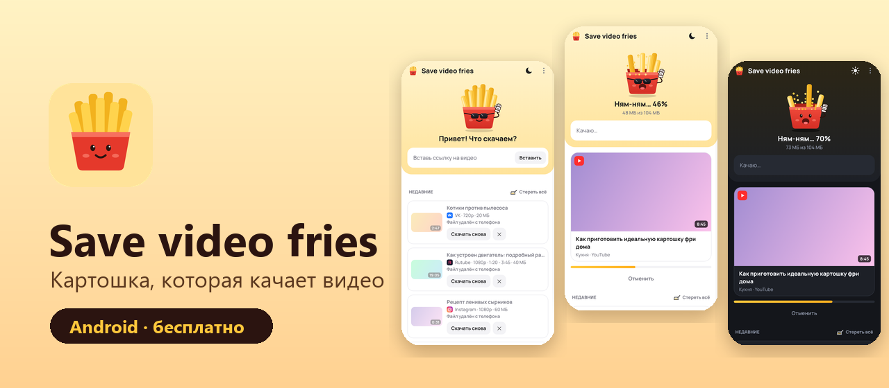
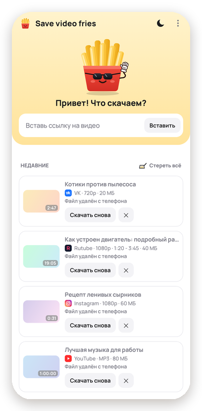
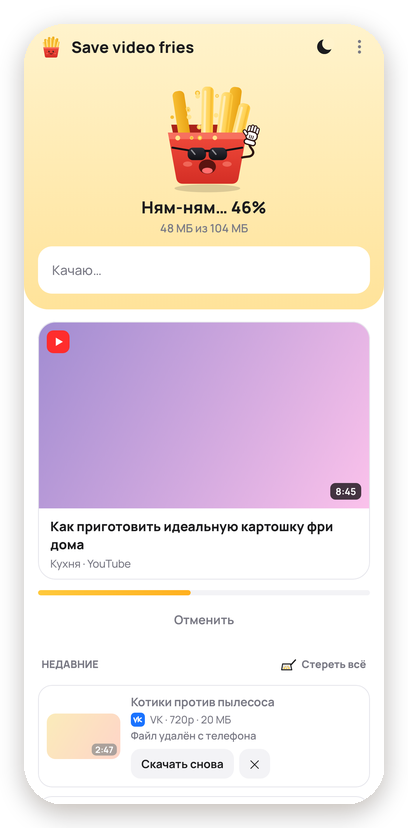
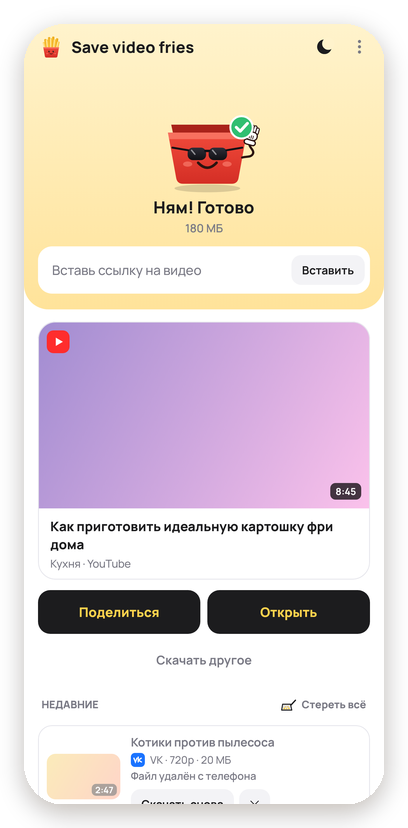
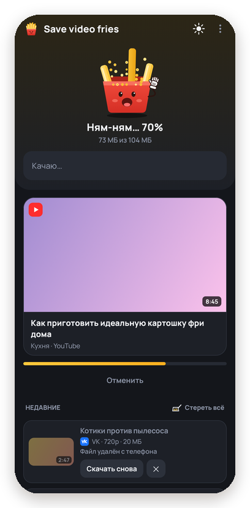
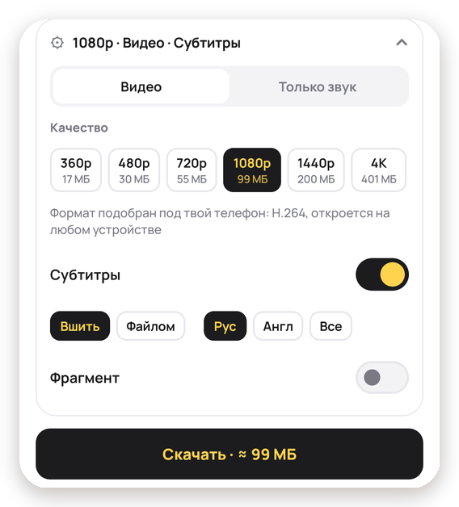
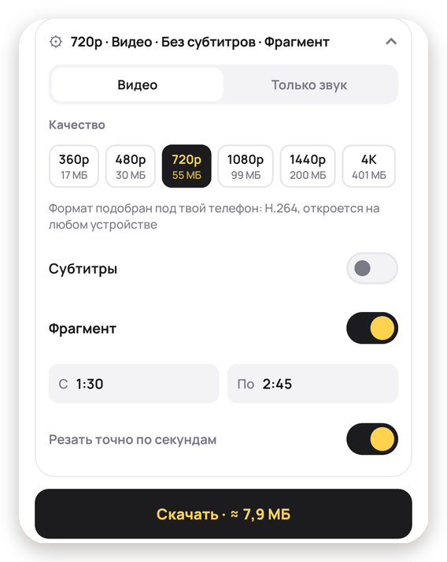
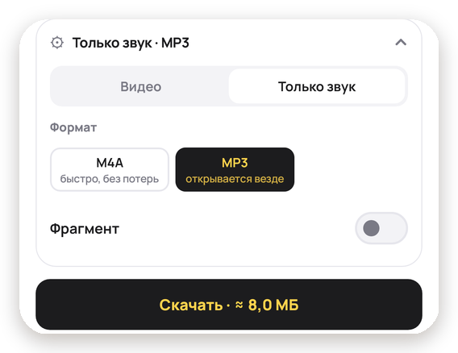

<b>Сохраняет видео и музыку по ссылке. Пока качается, картошка его ест.</b> 
YouTube · VK · Rutube · Instagram · Одноклассники · Дзен · Facebook · Twitch · Pinterest · SoundCloud · и ещё тысячи сайтов

<a href="../../releases/latest"><b>⬇️ Скачать последнюю версию</b></a> · Android 8 и новее · без рекламы

## Как пользоваться

1. Скопируй ссылку на ролик (или нажми «Поделиться» прямо в YouTube, VK, Instagram и выбери картошку).
2. Нажми «Вставить»: картошка найдёт видео и покажет варианты.
3. Выбери, что нужно, и жми «Скачать». Готово: видео уже в галерее.

## Что умеет

<table>
<tr>
<td width="50%" valign="top">
<h3>🎬 Качество на выбор</h3>

От 360p до 4K, если ролик такой есть. Рядом с каждым вариантом сразу видно, <strong>сколько он весит</strong>, ещё до скачивания.

Формат подбирается под твой телефон: видео откроется в галерее, а не покажет «формат не поддерживается», и без проблем перешлётся в мессенджер.

<h3>💬 Субтитры</h3>

<strong>Вшить прямо в видео</strong> или сохранить <strong>отдельным файлом</strong>. Язык: русский, английский или все сразу.

</td>
<td width="50%"></td>
</tr>
<tr>
<td width="50%"></td>
<td width="50%" valign="top">
<h3>✂️ Только нужный кусок</h3>

Включи «Фрагмент» и укажи время: <strong>с 1:30 по 2:45</strong>. Скачается только этот отрезок, а не весь двухчасовой стрим.

<ul>
<li>время можно писать как <code>1:30</code>, <code>90</code> или <code>1:02:15</code>;</li>
<li>если в ссылке уже есть таймкод (<code>?t=90</code>, <code>&amp;t=1m30s</code>), фрагмент <strong>начнётся с этого места сам</strong>;</li>
<li>«Резать точно по секундам»: до кадра, без лишнего в начале и в конце.</li>
</ul>
</td>
</tr>
<tr>
<td width="50%" valign="top">
<h3>🎵 Только звук</h3>

Подкаст, лекция, концерт, музыка из клипа:

<ul>
<li><strong>M4A</strong>: быстро и без потери качества;</li>
<li><strong>MP3</strong>: откроется на любой колонке, в машине и в старом плеере.</li>
</ul>

Файлы ложатся в «Музыку», их сразу видит любой плеер.

</td>
<td width="50%"></td>
</tr>
</table>

### И ещё

- 🔐 **Закрытые видео.** Вход в VK, Instagram и YouTube для групп «только для подписчиков» и закрытых профилей. Пароль приложение не видит: вход идёт на странице самого сайта.
- 📲 **«Поделиться» из любого приложения:** ссылка подставится сама, ничего копировать не надо.
- 🕘 **История:** всё скачанное под рукой, «Скачать снова» одной кнопкой, даже если файл уже удалён.
- 🔔 **Качает в фоне:** можно свернуть приложение, прогресс виден в уведомлении.
- 🌗 **Светлая и тёмная тема.**
- 🔄 **Обновляется само:** новые версии и починки сайтов приходят без поиска по интернету.

## А ещё картошка живая

Пока качается видео, картошка его ест. А ещё у неё своя жизнь: десятки сценок и секретов, которые открываются сами, если с ней поиграть. Что она умеет, не скажем: ищи в самой программе. Открытые сценки можно пересмотреть в меню «Картошкины сценки».

## Как установить

1. Скачай `Save_video_fries.apk` из [Releases](../../releases/latest) и открой его.
2. Телефон попросит разрешить установку из этого приложения (браузера или Telegram). Разреши.
3. Если Play Protect предупредит, нажми «Подробнее», затем «Всё равно установить». Так бывает с любым приложением не из Google Play.

## Обновления

Приложение само заглядывает сюда пару раз в день и предлагает обновиться. История и входы при обновлении сохраняются.

Проверить вручную: меню (три точки), «Проверить обновления».

## Полезно знать

- **YouTube и Instagram в России открываются только с VPN.** Если VPN включён, а скачивание не идёт, проверь в настройках VPN, что Save video fries идёт через него (раздельное туннелирование).
- **Сайт перестал скачиваться?** Сайты иногда меняются. Движок приложения обновляется сам, обычно всё чинится за пару недель.
- **Где файлы:** видео в «Фильмы/Save video fries», звук в «Музыка/Save video fries», субтитры в «Загрузки».
- **Музыкальные сервисы по подписке** (Яндекс Музыка, Spotify и т.п.) не поддерживаются. Найди песню на YouTube или в VK-видео и скачай «Только звук».

## Приватность

- Ссылки, видео, названия роликов, аккаунты и файлы никуда не отправляются, кроме сайта, с которого качаешь.
- Раз в день приложение отправляет **анонимную сводку**: случайный номер установки, версию, сколько видео скачано и сколько сценок открыто (без названий). Это помогает понять, сколько людей пользуется картошкой. Выключить: «О программе» → «Анонимная статистика».
- Ещё приложение ходит в интернет за обновлениями: своими (сюда) и движка (на GitHub).
- Пароли от аккаунтов приложение не видит. Сохраняется только пропуск сайта, зашифрованным, на этом телефоне.

## Что-то не так?

На карточке ошибки нажми «Сообщить автору»: приложение скопирует отчёт. Пришли его в [Issues](../../issues) вместе со ссылкой на ролик.

## Поддержать автора

Картошка бесплатная. Захочешь, [закинь картохе крохи](https://pay.cloudtips.ru/p/a3101c6c). Не захочешь, пользуйся в удовольствие!

## Ответственность и лицензии

Скачивай только то, на что у тебя есть право: свои видео, ролики под свободной лицензией, для личного просмотра.

Приложение использует открытые проекты [yt-dlp](https://github.com/yt-dlp/yt-dlp), [youtubedl-android](https://github.com/yausername/youtubedl-android) (GPL-3.0) и [FFmpeg](https://ffmpeg.org). Исходный код приложения предоставляется по запросу.
